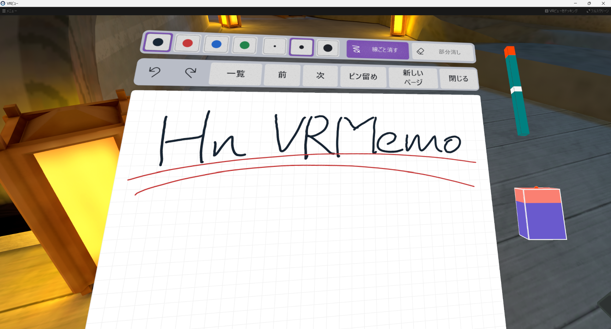
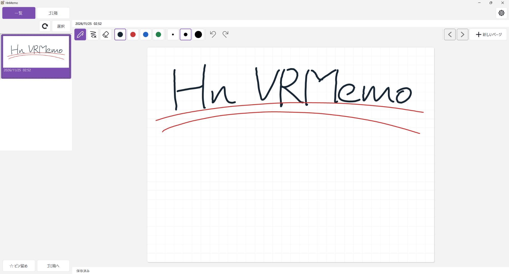

# HnMemo

SteamVR の空間にノートを出して手書きできる、Windows 用の手書きメモ帳です。  
VRChat をプレイしながら思いついた数式・単語・アイデアを数秒で書き留め、あとから VR 内でも PC 画面でも見返したり書き足したりできます。自分用に作ったので、使いたい方がいれば使ってください。

| VR 内での手書き | PC 画面での閲覧・編集 |
| :---: | :---: |
|  |  |

## 主な特徴

- **VRChat と同時起動してすぐ書ける**：ペンとノートをグリップで掴み、トリガーで書く直感的な操作（QvPen に近い操作感）。
- **手首タップでサッと出し入れ**：ダッシュボードを開かず、手首付近を 2 回タップするだけでノートを表示・非表示にできます。SteamVR の任意ボタンへの割り当ても可能です。
- **PC 画面からも閲覧・編集**：同じメモを PC のウィンドウ上でマウスやペンタブレットを使って書き直したり、一覧・ピン留め・ゴミ箱で整理したりできます。
- **自動保存で消えにくい**：書いている間も約 1 秒ごとに自動保存。再編集用の **JSON** と、見返し用の **PNG** を両方残します。
- **広さを変えられるノート**：角（つまみ）を引くだけで、筆跡の実寸を保ったまま書ける面積を広げられます。

## 動作環境・注意事項

- **対応 OS**：Windows 10 / 11（64bit）
- **VR 利用時**：PCVR 環境（SteamVR + 対応コントローラー）が必要です。Meta Quest 単体では動作しません。
  - Quest 系・Valve Index・HTC Vive の既定コントローラーバインドを同梱しています。
- **PC 画面のみ**：SteamVR を起動していなくても利用できます。
- **追加ランタイム不要**：配布版は .NET を同梱しているため、別途ランタイムを入れる必要はありません。
- **非公式ツールについて**：SteamVR・VRChat の非公式ツールです。**グリップやトリガーの入力は VRChat 側にも届く**ため、アバターやワールドの操作と競合する場合があります。
- **SmartScreen の警告**：コード署名のないアプリのため、インストールや起動時に Windows SmartScreen の警告が出ることがあります。公式の配布元（BOOTH または本リポジトリの Releases）から入手したことを確認のうえ、「詳細情報」→「実行」を選んでください。

## ダウンロードとインストール

以下のいずれかから最新のインストーラー（`HnMemo-*-win-x64-setup.exe`）をダウンロードしてください。

- **BOOTH**：<!-- BOOTH 公開後にショップページ URL を設定 -->（公開準備中）
- **GitHub Releases**：[最新版をダウンロード](https://github.com/pealsha/hn-vr-memo/releases/latest)

### はじめかた

1. ダウンロードした `HnMemo-*-win-x64-setup.exe` を実行し、画面に沿ってインストールします（既定のインストール先は `C:\Program Files\HnMemo`）。
2. 完了画面の「HnMemo を起動する」、またはスタートメニューの「HnMemo」から起動すると PC 画面が開きます。
3. SteamVR を起動し、VR 内でダッシュボードの **HnMemo** タブから「ノートを出す」を選んでダッシュボードを閉じます。
4. ノートの横にあるペンをグリップで掴み、ペン先をノートの手前 15 cm 以内に入れてトリガーを引くと書けます。

> [!TIP]
> 2 回目以降は、ダッシュボードを開かずに**手首タップ**（利き手と反対の手首付近を見ながら 2 回軽く叩く）でノートを出し入れできます。反応しづらい場合は、PC 設定またはダッシュボードの「手首の位置を合わせる」で好きな位置を登録できます。

## 基本の操作

### VR での操作

| やりたいこと | 操作 |
|---|---|
| ノートを出す・隠す | 反対の手首付近を見ながら 2 回タップ（またはダッシュボード／SteamVR 任意割り当て） |
| ペン・消しゴムを持つ | 道具に手を近づけてグリップを握る（離すとその場に留まる） |
| 書く・消す | 道具の先をノート手前 15 cm 以内に入れてトリガーを引く |
| 色・太さ・消し方を変える | ノート上部のパレットに道具の先を重ねてトリガーを押す |
| ノートを動かす | 空いた手を紙に近づけ、グリップを握ったまま移動する |
| ノートの広さを変える | 紙の下端の矢印をグリップ、または道具の先を重ねてトリガーで引く |

### PC 画面での操作

- 左の一覧からページを選び、右の紙へマウスやペンタブレットで書けます。VR で開いているページともリアルタイムに同期されます。
- ウィンドウを閉じると通知領域（タスクバーの時計付近）に常駐し、VR ではそのまま使えます。アプリを完全に終了するときは、通知領域アイコンを右クリックして「終了」を選びます。

### 詳しい使い方・設定・トラブルシューティング

手首タップの詳しい条件、SteamVR のボタン割り当て、PC 画面のページ整理（ピン留め・複数選択・ゴミ箱）、設定項目、更新・アンインストール手順、トラブル時の対処は **[詳細ガイド（distribution/README.md）](distribution/README.md)** にまとめています。  
不具合や気づいた点があれば [Issues](https://github.com/pealsha/hn-vr-memo/issues) でお知らせください。

## 保存先とデータ

- 既定の保存先：`ドキュメント\HandwriteMemo`（PC 画面右上の歯車 →「保存先を開く」から開けます）
- 保存形式：再編集用の **JSON** と見返し用の **PNG** を自動保存します。
- アプリを更新・アンインストールしても、メモと設定は自動で消去されません。
