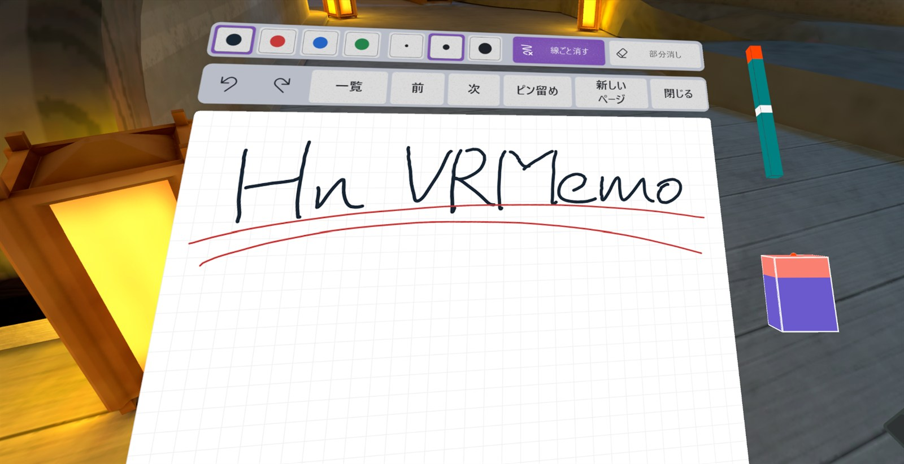

# HnMemo

SteamVR の空間にノートを出して手書きするための Windows アプリです。VRChat と同時に使え、書いたメモは PC 画面から見返したり書き足したりできます。自分用に作ったので、使いたい方がいれば使ってください。

## インストール

1. [Releases](https://github.com/pealsha/hn-vr-memo/releases) から `HnMemo-*-win-x64-setup.exe` をダウンロードして実行する（Windows 10 / 11 64bit、.NET ランタイム同梱）
2. スタートメニューから「HnMemo」を開く

未署名の実行ファイルのため、初回に Windows の SmartScreen 警告が表示される場合があります。入手元を確認し、信頼できる場合のみ「詳細情報」→「実行」を選択してください。

## 使い方

SteamVR を起動した状態で、手首タップ（右利きなら何も持たず左手の手首付近を見ながら右手の指先で 2 回軽く叩く）か、SteamVR ダッシュボードの **HnMemo** タブからノートを出します。ペン・消しゴム・ノートはグリップで掴み、道具の先を紙や上部ボタンに近づけてトリガーで操作します。右下の矢印（左利きは左下）を引くと、ノートの面積を広げられます。

書いた内容は「ドキュメント」内の `HandwriteMemo` フォルダに JSON と PNG で自動保存されます。あとから PC 画面の左の一覧で開き直して書き足しや整理ができ、PC のみの利用なら SteamVR なしでも起動できます。ウィンドウを閉じても通知領域に常駐するため、完全に終了するときは通知領域のアイコンを右クリックして「終了」を選択します。

## 注意事項

SteamVR・VRChat の非公式ツールのため、グリップやトリガーの入力は VRChat にも届き、アバターやワールドの操作が同時に反応する場合があります。

---

手首の位置合わせ、SteamVR の任意ボタン割り当て、設定変更、アンインストール、困ったときの確認事項は [詳細ガイド（distribution/README.md）](distribution/README.md) にまとめています。

不具合や気づいた点があれば [Issues](https://github.com/pealsha/hn-vr-memo/issues) でお知らせください。ビルドや構成は [docs/DEVELOPMENT.md](docs/DEVELOPMENT.md)・[docs/ARCHITECTURE.md](docs/ARCHITECTURE.md)・[docs/storage-format.md](docs/storage-format.md) を、ライセンスは [LICENSE（MIT）](LICENSE) および [THIRD-PARTY-NOTICES.md](THIRD-PARTY-NOTICES.md) を参照してください。
