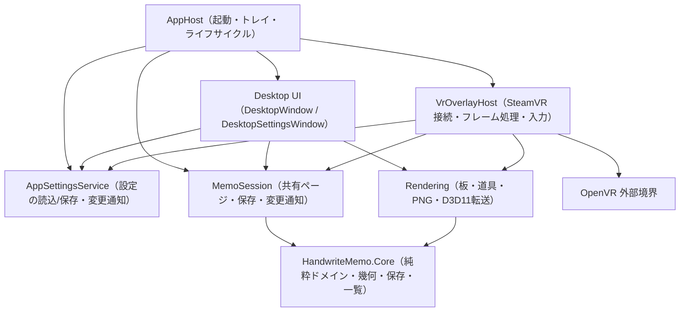

# HnVRMemo アーキテクチャ

HnVRMemo は WinForms と SteamVR オーバーレイから同じメモを編集する Windows アプリです。

## 全体構成と依存の向き

- **依存は上から下への一方向**とし、`Core` は .NET の標準ライブラリで動作します。
- **Desktop と VR は対等なクライアント**であり、互いのクラスに直接依存せず `MemoSession` と `AppSettingsService` の状態・変更通知を通して同期します。

## プロジェクトとフォルダの責務

| 場所 | 責務 | 置いてはいけないもの |
|---|---|---|
| `src/HandwriteMemo.Core` | 物理寸法（メートル基準）、投影筆記・掴み・消しゴム・ジェスチャー判定、JSON 保存・ページ一覧・ゴミ箱 | WinForms・OpenVR・D3D11 依存、UI のピクセル配置や表示文言 |
| `src/HandwriteMemo.App/Session` | PC と VR で共有する編集中ページの状態、自動保存の制御、保存先移動 | `MessageBox` などの UI 表示、VR 専用画面状態 |
| `src/HandwriteMemo.App/Desktop` | PC 画面、一覧の選択・プレビュー、ページ整理、キャンバスのペン入力 | VR オーバーレイのライフサイクルへの直接依存 |
| `src/HandwriteMemo.App/Vr` | SteamVR 接続、入力・姿勢・オーバーレイ描画ループ、自動起動登録 | PC 画面専用の状態管理、アプリ全体の所有権 |
| `src/HandwriteMemo.App/Rendering` | ノート・ツールパネル・オーバーレイ画像・縮小画像・保存 PNG の描画、D3D11 転送 | アプリ設定や業務ワークフロー |
| `src/HandwriteMemo.App/Ui` | PC・VR 共通の色・寸法トークン（`UiDesign`）とベクターアイコン | 片方の画面専用の業務ロジック |
| `src/HandwriteMemo.App/Diagnostics` | 起動時に最新20件へ整理する実行ログ（`RunLog`） | 開発時の計測注釈や無制限ファイル増殖 |
| `vendor/openvr` | Valve 公式 C# バインディングとネイティブ DLL（無改変） | 独自改変 |

## 設計方針

- **軽量・直接的な構成を保つ**：約1万行規模のアプリのため、DI コンテナや MVVM フレームワークは導入しません。
- **インターフェースは外部境界だけ**：OpenVR API・時計・UI 通知など外部と接する境界だけ薄く抽象化し、テストのための Reflection や大量の `internal` 公開を避けます。
- **同期は変更通知、レイアウトは1パス**：UI 同期に定期ポーリングタイマーや `Application.DoEvents()` を増やさず、変更イベントを使います。`OnLayout` の最中に別コンテナの寸法を書き換えないようにします。
- **保存先を管理対象に絞る**：保存先移動は、保存先のルートと配下で扱うゴミ箱・ページファイルのリンクを拒否します。保存先より上にあるフォルダは、Windows のフォルダリダイレクトを許容します。
- **`partial class` で巨大化を隠さない**：1ファイル 300〜400 行を超えそうなら、責務単位で別クラスへ分離します。

## 実行時の同期

- `AppHost` は WinForms のメッセージループで起動通知、ゴミ箱の期限、SteamVR の接続監視を扱います。VR フレームの処理も同じ STA スレッドで実行し、PC と VR が同じページを順番に更新します。
- `AppSettingsService` と `MemoSession` が設定・ページの変更を通知します。PC 画面は変更を受けて表示を更新し、VR の一覧表示は `VrPageBrowser` が持ちます。保存の失敗と復旧コピーの通知は `AppHost` が表示します。
- `VrOverlayHost` は SteamVR との接続を持ち、`VrOverlayView` がオーバーレイの描画を担当します。自動起動の予約は `AutoStartCoordinator` が接続時の Applications インターフェースで反映します。本番の OpenVR アダプタとテスト用フェイクは同じ外部境界を使います。

## PC 画面

- `DesktopWindow` は画面構成・イベント・`MemoSession` からの表示更新を担当します。`DesktopCatalogView` は一覧の行・サムネイル・選択を持ち、一覧の更新中に起きた選択イベントをカウンタ式のスコープで抑えます。
- `DesktopPageActions` はページ移動・複製・改名・ピン留め・ゴミ箱の一括操作をまとめます。アクティブページを変更するときは `MemoSession` を経由します。
- `MemoCanvas` は、ライブページの編集・閲覧と、ゴミ箱の閲覧用プレビューを区別します。ゴミ箱に対象がなければ白紙を表示します。

## VR 描画

- `VrOverlayView` は可視フレームごとにボード・ツールパネル・道具の姿勢を更新します。ページ、筆跡と追記中の線、寸法、カーソル、道具、履歴、案内、一覧、強調表示の状態キーが変わるとボードとツールパネルを描画・転送します。ノートを再表示したときは初回更新を強制します。
- `BoardPainter` はボードとページ一覧、ツールパネルを描画し、完成した線と筆記中の線のビットマップを再利用します。`VrOverlaySprites` はダッシュボード・マーカー・拡大ハンドル・手首の案内などの画像を作ります。`VrTheme` の粒子模様は、固定シードのタイルを描画面上の同じ座標から繰り返します。
- `VrSessionResources` は SteamVR 接続ごとのオーバーレイと D3D11 テクスチャを保持します。

## 保存と検証

- `GrabScene` のフレーム結果はペンと消しゴムの姿勢・先端・保持・入力を `ToolGrabState` で表します。入力判定は Core、ボタンや案内の文言は App に置きます。
- `BoardMetrics` の 48×36 cm／1024×768 px が基準です。`MemoStore` は JSON v2、旧 v1 の読み込みとバックアップを扱い、`MemoRenderer` が PNG を生成します。PC と VR は同じ `MemoSession` の保存処理を使います。
- Core・Storage・App の検証は MSTest 3.8.3 で実行します。Windows UI のテストは STA で動かし、OpenVR の外部境界をテスト用実装に差し替えます。詳しい実行方法は [開発手順](DEVELOPMENT.md) にあります。
